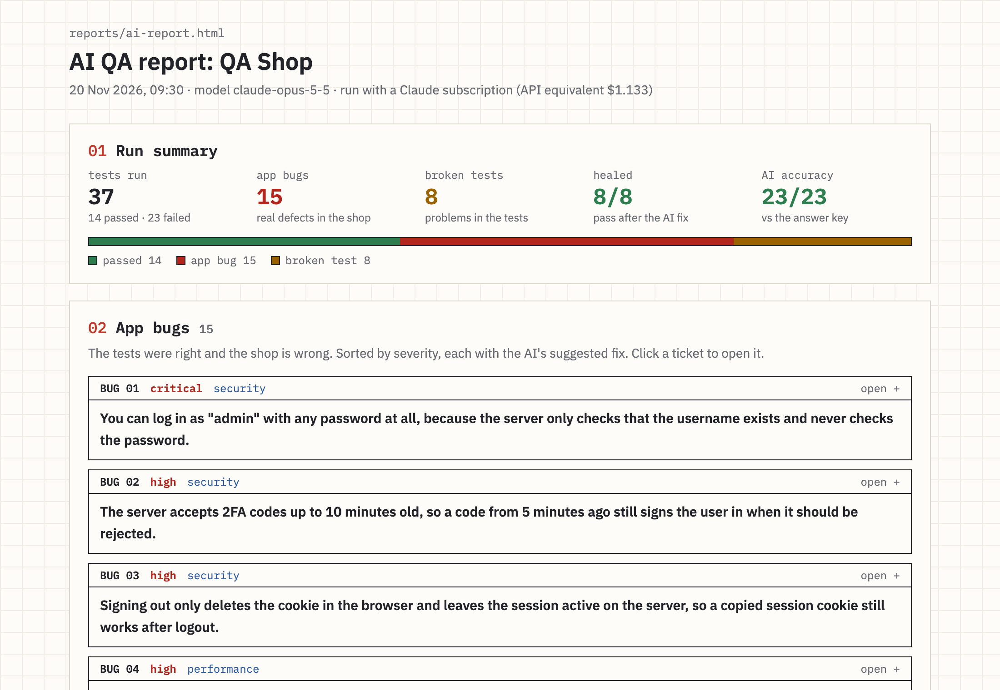
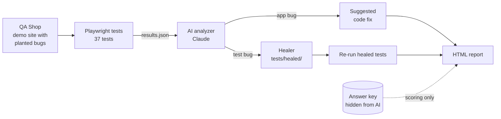
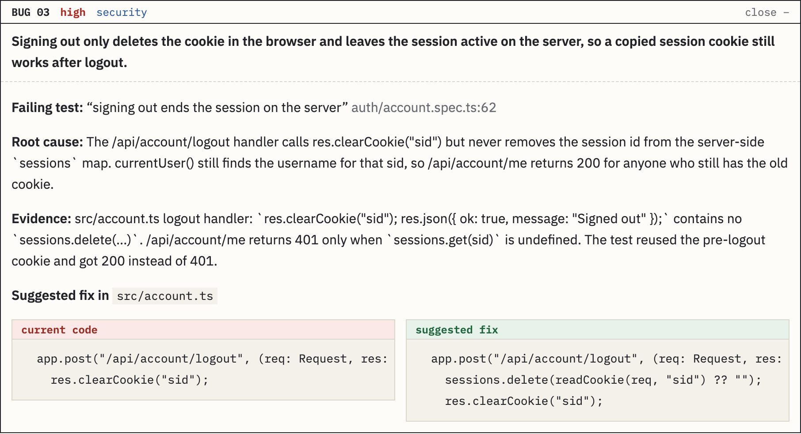
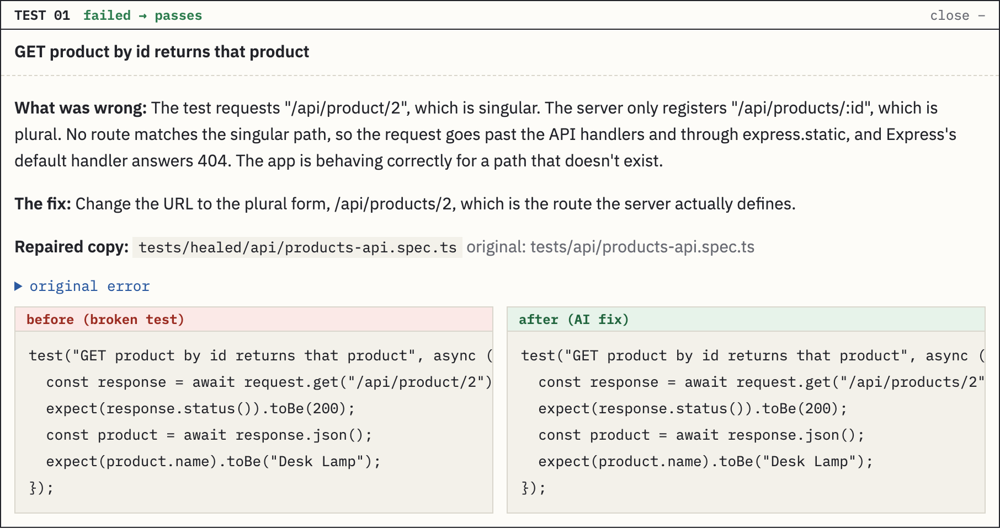

# AI QA Lab

[](https://github.com/adidaGross/ai-qa-lab/actions/workflows/ci.yml)
[](https://adidagross.github.io/ai-qa-lab/)

I've worked in QA for over nine years, and after almost every test run my teams lost time on the same question: **is this a real bug in the product, or did the test break?** Answering it means reading the error, the test and the app code, one failure at a time.

This project is my attempt to hand that question to an AI, and to check its answers instead of trusting them. It has:

- a small online shop with 15 bugs I planted on purpose,
- 37 Playwright tests for it (UI, API, 2FA and passkey sign-in, security, load), 8 of them broken on purpose,
- an AI step that decides, for each failing test, whether the app or the test is wrong, suggests a fix, and writes fixed copies of the broken tests, which are then run again,
- an answer key the AI never sees, and a mutation benchmark that generates new cases to test the AI on.

Built with TypeScript, Playwright and Claude.



---

## How I approached it

- **Measure the AI, don't trust it.** An answer key and a mutation benchmark turn "the AI seems right" into numbers.
- **A fixed answer format.** The AI has to answer in a JSON schema checked with Zod. A bad answer fails loudly instead of slipping into the report.
- **People decide.** Fixed tests go to a separate folder for review. The AI never rewrites the real test suite.
- **Prove the fix.** A fixed test only counts if it passes when run again.
- **Test the tests.** CI checks that the suite fails in exactly the expected way. If a planted bug stops being caught, or a new failure shows up, the build goes red.
- **Safe output.** Report text is escaped, so the report can't have the XSS bug the project tests for. Keys live in a git-ignored `.env` and are typed with hidden input.
- **Know the cost.** Every AI run prints its estimated cost, and the fixed part of the prompt is cached to keep it down.
- **Runs anywhere.** Linux, macOS and Windows on every push, and one setup command that times itself.
- **Not tied to one AI.** One function, four backends (Claude through a subscription or the API, a local model through Ollama, or any OpenAI-compatible service), all checked against the same schema.

## About the AI part

The AI code lives in a separate private package, Faultwise, which I'm also developing. This repo installs it like any other dependency. If you don't have access, `npm install` skips it: the tests, the baseline check, the healed tests and the website all work without it. Only the AI steps (`npm run verify-fixes` and the benchmark's AI phase) need it.

## Results

The recorded run has 23 failures: 15 planted app bugs and 8 tests I broke on purpose, across UI, API, 2FA and passkey sign-in, security and load tests.

| Metric | Result |
|---|---|
| Failures classified correctly (app bug vs test bug) | **23 / 23** |
| Planted app bugs found | **15 / 15** |
| Broken tests found | **8 / 8** |
| Healed tests passing after the AI fix | **8 / 8** |
| AI cost per full run | **$0 on a Claude subscription** (API equivalent $1.13); ≈ $0.50 on the Claude API (estimated) |

> These numbers come from a small demo I control. Real projects are messier, and AI answers vary between runs. That's why I built the answer key, the scorer and the mutation benchmark below.

## Mutation benchmark

A couple of dozen hand-made cases don't prove much, so I wrote a generator in [`benchmark/`](benchmark) that makes new ones:

1. Build a **clean baseline**: all planted bugs fixed, all broken tests repaired, so every test passes.
2. Generate **mutants**: one realistic change each, in the **app** (the truth is *app bug*) or in a **test** (the truth is *test bug*). Sampling is seeded, so every run is reproducible.
3. Run the suite on every mutant. Mutants that no test catches reveal **gaps in the test suite** (mutation score).
4. The AI triages every failure without knowing the truth, once per **configuration** (model + context), and is graded.

Two levels:

- **Basic**: one-line changes such as a flipped condition, a changed number, a wrong selector, or a wrong expected value.
- **Hard**: changes designed to **look like the other kind of problem**. Subtle app bugs (wrong field, boundary, missing `await`, weakened validation, statement order) and believable test mistakes (checking a real but wrong element, using another real product, a plausible wrong number, swapped steps).

> The recorded results below come from the 21-test version of the suite, before the 2FA and passkey area was added. The same commands now include it.

### Results: hard level (83 mutants → 115 test failures, each judged by 5 configurations)

| Model : context | Accuracy | 95% range | Answered | Avg time |
|---|---|---|---|---|
| **Opus 5.5 : full** | **100%** (115/115) | 96.8–100% | 115/115 | 12.5 s |
| **Sonnet 5.5 : full** | **100%** (115/115) | 96.8–100% | 115/115 | 5.8 s |
| Haiku 5.5 : full | 64.3% | 55.3–72.5% | 77/115 (96.1% right when it answered) | 11.4 s |
| Opus 5.5 : minimal | 73.0% | 64.3–80.3% | 115/115 | 17.0 s |
| Haiku 5.5 : minimal | 47.0% | 38.1–56.0% | 90/115 (60.0% right when it answered) | 12.6 s |

*Full* = the AI sees the app's source code. *Minimal* = only the failing test and the error, as on a large codebase. *Answered* = the model returned a valid structured answer; failures count as wrong in *Accuracy*.

What the benchmark shows:

- **Context matters more than the model.** Opus drops from 100% to 73% without the app's code. Its mistakes have a clear pattern: it **blames the test for subtle app bugs** (a missing `await` was called a test bug 12 times), because without the code a broken page looks like a broken test.
- **The AI's confidence is honest.** Without the code, Opus was right 19/19 times when it said "high" but only 20/44 when it said "low". So confidence can route uncertain cases to a person.
- **Sonnet matches Opus here at about half the time and cost**, so on this task the cheaper model is the better choice.
- **Haiku's weakness is reliability, not judgment**: with the code it was right 96% of the time when it answered, but it failed to produce valid structured output for a third of the failures.
- **Mutation score: 72.7% (hard) and 66.7% (basic).** The tests miss real changes. For example, removing the "−" button's click handler is not caught, because the test expects quantity 1, which a dead button also produces. I left these gaps in on purpose, to show that the benchmark finds weak spots in the tests, not only in the app.

### Results: basic level (60 mutants → 64 test failures, each judged by 5 configurations)

| Model : context | Accuracy | 95% range | Answered | Avg time |
|---|---|---|---|---|
| **Opus 5.5 : full** | **100%** (64/64) | 94.3–100% | 64/64 | 10.8 s |
| **Sonnet 5.5 : full** | **100%** (64/64) | 94.3–100% | 64/64 | 5.4 s |
| Haiku 5.5 : full | 75.0% | 63.2–84.0% | 48/64 (100% right when it answered) | 10.7 s |
| Opus 5.5 : minimal | 89.1% | 79.1–94.6% | 64/64 | 14.6 s |
| Haiku 5.5 : minimal | 62.5% | 50.3–73.3% | 50/64 (80.0% right when it answered) | 11.9 s |

The same patterns as the hard level, on easier changes: without the app's code, every mistake was an app bug blamed on the test, and Haiku's misses were invalid answers rather than wrong judgments. Opus with full context scored 64/64 on these mutants in two separate runs.

**Cost of the benchmark runs** (both on a Claude subscription, **$0 billed**): basic, 320 AI calls in 18 min, API equivalent $6.41; hard, 575 AI calls in 35 min, API equivalent $11.69.

Full reports: [`hard-report.html`](benchmark/results/hard-report.html), [`basic-report.html`](benchmark/results/basic-report.html).

> Limits: a small codebase, mostly single-line changes, one run per configuration. Changes whose correct label is a matter of intent (such as renaming a `data-testid`) are excluded, because they cannot be graded fairly.

### Running the benchmark

| Command | What it does | AI cost |
|---|---|---|
| `npm run bench:basic` | 60 basic mutants, AI triage with Opus 5.5 (full context) | subscription (API equivalent ≈ $2.76) |
| `npm run bench:hard` | Up to 100 hard mutants, AI triage with Opus 5.5 (full context) | subscription (API equivalent ≈ $4.65) |
| `npm run bench:basic:compare` | Basic level, judged by all 5 configurations | subscription (API equivalent ≈ $6.41) |
| `npm run bench:hard:compare` | Hard level, judged by all 5 configurations | subscription (API equivalent ≈ $11.70) |
| `npm run bench:mutation` / `bench:mutation:hard` | Mutation testing only: which changes do the tests catch? | – |
| `npm run bench:reports` | Rebuild both HTML reports from the saved results | – |

Custom runs: `npm run bench -- --level hard --cases 100 --seed 42 --configs opus:full,haiku:minimal` (add `--skip-ai` for no AI).

| Mode | Used | How it connects | Cost of a benchmark run |
|---|---|---|---|
| `max` (default locally) | Your own computer | Claude Code CLI with your Claude subscription | **$0 billed.** The "API equivalent" above is what the same calls would cost at API list prices. |
| `api` (`AI_MODE=api`) | Any machine with `ANTHROPIC_API_KEY` | Claude API directly | Billed per use. Expect **less** than the API equivalent, since there are no Claude Code instructions added to each call (the main flow, measured on the earlier 21-test version: $0.29 on the API vs. $0.64 equivalent through Claude Code). |

API list prices per million tokens: Opus 5.5 $4 in / $20 out · Sonnet 5.5 $2 / $10 · Haiku 5.5 $0.10 / $0.50.

## How it works



1. **The shop.** A small online shop ([`site/`](site), [`src/server.ts`](src/server.ts), [`src/account.ts`](src/account.ts)) with 15 bugs planted on purpose: functional, validation, API, security (XSS, auth, 2FA, sessions, brute force, information leaks), performance and accessibility.
2. **The tests.** 37 Playwright tests: UI, API, sign-in, security and load. 14 pass, 15 correctly catch the app bugs, and 8 are broken on purpose (wrong selector, wrong expected value, bad test data, wrong step order, missing wait, wrong URL, a hard-coded 2FA code, a header name in the wrong case).
3. **AI analysis** ([`ai/analyze.ts`](ai/analyze.ts)). For each failure, Claude receives the error, the test file and the app source, and returns **structured JSON**: classification, confidence, root cause, evidence, and either an app code fix or a corrected test.
4. **Self-healing** ([`ai/heal.ts`](ai/heal.ts)). Corrected tests are written to `tests/healed/` with **the same file name and test name** as the original, then run again to prove the fix works. The original tests are never modified: a person reviews the fix first (human-in-the-loop).
5. **Scoring** ([`ai/score.ts`](ai/score.ts)). The AI's answers are graded against an answer key it never sees.
6. **Report** ([`ai/report.ts`](ai/report.ts)). One HTML page with a dashboard, app bugs sorted by severity with suggested fixes, healed tests with before/after code, and the accuracy table.

## Testing 2FA and passkeys

Sign-in with a 2FA code or a passkey is where test automation usually stops: the code is on someone's phone, and the passkey needs a fingerprint. The shop's **My account** area ([`src/account.ts`](src/account.ts)) has both, and the tests get through them without a person ([`tests/support/account.ts`](tests/support/account.ts)):

| Sign-in step | How the tests handle it |
|---|---|
| **2FA code** (authenticator app, TOTP) | The test computes the 6-digit code from the test account's 2FA secret, exactly as the app on a phone does. No fixed codes, no phone. In CI the secret comes from `TEST_TOTP_SECRET`. |
| **Passkey** (WebAuthn) | Chromium's built-in **virtual authenticator**, switched on through the DevTools protocol, acts as the passkey device: it creates and uses real passkeys and "touches the sensor" automatically. |
| **Staying signed in** | Each test worker signs in once through the API and saves the session cookies; tests that just need a signed-in user start from that saved session (`signedInPage`). |

The 8 tests in [`tests/auth/account.spec.ts`](tests/auth/account.spec.ts) cover 2FA sign-in, wrong and expired codes, creating and using a passkey, an unknown passkey, a saved session, and that signing out really ends the session on the server. Two of them catch planted **security** bugs (BUG-011: codes from 10 minutes ago still work; BUG-012: sign-out only clears the browser's cookie, so a copied cookie keeps working). One is broken on purpose (TEST-007: it types a 2FA code copied from the phone once, so it can never pass again), and the AI heals it by using the code generator.

Adding the account area also exposed a weak test: the old check `getByLabel("Password")` started passing because it found the *new* password field, hiding the planted missing-label bug. It now checks the login form's own field.

## Security and load tests

**Security** ([`tests/security/security.spec.ts`](tests/security/security.spec.ts)), on top of the XSS and sign-in checks:

| Test | Checks | Result |
|---|---|---|
| Browser security headers | `nosniff`, `X-Frame-Options: DENY` (clickjacking), `Referrer-Policy` | passes |
| Session cookie | `HttpOnly` (scripts can't read it) and `SameSite=Strict` (other sites can't send it) | passes |
| Access control | creating a passkey without being signed in is refused (401) | passes |
| 2FA brute force | after 5 wrong codes the 6th try is refused (429) | **catches BUG-013** (the limit is 50) |
| Information leaks | an error response must not contain stack traces or server file paths | **catches BUG-014** |
| Header check on the API | | **broken on purpose (TEST-008)**: reads `"X-Content-Type-Options"`, but Playwright gives header names in lowercase |

The leak test reports only *that* something leaked, never the leaked text itself, so server paths don't end up in test reports either.

**Load** ([`tests/load/load.spec.ts`](tests/load/load.spec.ts)): many virtual users send requests at once for a few seconds, and the test measures p50/p95 response times and errors against a limit. Each load test starts its **own copy of the shop** on a separate port ([`tests/support/load.ts`](tests/support/load.ts)), so the heavy traffic never slows down the other tests running at the same time.

| Test | Load | Limit | Result |
|---|---|---|---|
| Product API | 30 users for 3 s | 0 errors, p95 < 300 ms | passes |
| Browsing while users sign in | 10 users signing in + 5 browsing, 3 s | browsing p95 < 150 ms | **catches BUG-015**: password hashing with `scryptSync` blocks the whole server, so browsing p95 jumps to about 1 s. The async `crypto.scrypt` keeps it in the low milliseconds. |

The load tests are left out of the mutation benchmark: timing limits would be unreliable with several mutants running at the same time.

### Suggested fix for an app bug


### A broken test, healed by the AI


## Quick start

**Works on Linux, macOS and Windows** (all three are tested on every push). **Requirements:** Node.js 22+ and, for the AI steps, either [Claude Code](https://claude.com/claude-code) logged in with a Claude subscription, or a [Claude API key](https://console.anthropic.com).

```bash
git clone https://github.com/adidaGross/ai-qa-lab.git
cd ai-qa-lab
npm run setup
```

`npm run setup` ([`scripts/setup.mjs`](scripts/setup.mjs)) does everything a new user needs and times each step: checks Node, installs the packages, downloads Chromium, runs the 37 tests and checks they fail exactly as the answer key expects, and tells you how the AI will be reached (without calling it). Then `npm run ai:check` makes one tiny AI call to confirm the connection.

### How long the installation takes

Measured by `npm run setup` on GitHub's Ubuntu, macOS and Windows machines (Node 22, empty package cache):

| System | Install packages | Download Chromium | First test run (37 tests) + baseline | **Total** |
|---|---|---|---|---|
| Ubuntu | 3–5 s | 17 s – 3 min ¹ | 37 s | **≈ 1 min** (up to 4 min) |
| macOS | 3–5 s | 8–12 s | 29 s | **≈ 40 s – 1 min** |
| Windows | 10–12 s | 13–18 s | 43 s | **≈ 1 min** |

¹ On Linux the step also installs the browser's system libraries with `apt`, so its time depends on the package mirror.

These are fast data-center connections. On a home connection, expect the Chromium download to take longer (the browser uses about 580 MB of disk once unpacked); everything else stays about the same. The latest timings are on the Summary page of every [CI run](https://github.com/adidaGross/ai-qa-lab/actions/workflows/ci.yml).

### Which AI it uses

It is not tied to Claude. Four modes, all returning the same validated JSON, so the rest of the pipeline doesn't know or care which one ran:

| Mode | Used for | How it connects | Cost |
|---|---|---|---|
| `max` (default locally) | Your own computer | Claude Code CLI (`claude -p --json-schema …`) with your Claude subscription | No API credits |
| `api` (default on GitHub Actions) | The live website, CI | Claude API with `ANTHROPIC_API_KEY` | Pay per use (≈ $0.50 per run) |
| `ollama` | Code that must not leave the company | A local open model through [Ollama](https://ollama.com) (`OLLAMA_HOST`, `OLLAMA_MODEL`, default `gpt-oss:20b`) | Free; runs on your machine |
| `openai` | Teams that already pay another vendor | Any OpenAI-compatible chat API: OpenAI, Google Gemini, Azure OpenAI, Mistral, Groq, LM Studio, vLLM (`AI_BASE_URL`, `AI_API_KEY`, `AI_MODEL`) | That vendor's prices (not tracked here) |

Pick a mode with `AI_MODE`, or put it in front of the model name, which also works in the CLI, the Action and the benchmark: `--model ollama/gpt-oss:20b`, `--model openai/gpt-5-mini`, `--configs opus:full,ollama/gpt-oss:20b:full`. So the benchmark can compare a local model against Claude on the same failures.

Accuracy of a real local model is not measured yet: run `npm run bench -- --level hard --configs ollama/gpt-oss:20b:full,sonnet:full` after installing Ollama and pulling the model. Switch with `AI_MODE=api npm run verify-fixes`. To use the API locally, save your key with `npm run ai:set-key` (hidden input, stored in the git-ignored `.env`). In `max` mode the key is removed from Claude Code's environment, so the subscription is always what pays.

Run everything (clean old reports → tests → AI analysis → healing → report):

```bash
npm run verify-fixes
```

Then open the report: start the shop with `npm start` and visit <http://localhost:3000/reports/ai-report.html>.

## Commands

| Command | What it does | AI cost |
|---|---|---|
| `npm run setup` | First-time setup: packages, Chromium, a test run and the baseline check, with timings | – |
| `npm start` | Start the QA Shop at http://localhost:3000 | – |
| `npm test` | Run the main Playwright suite | – |
| `npm run report` | Open Playwright's own HTML report | – |
| `npm run test:baseline` | Check the suite fails exactly as expected (used in CI) | – |
| `npm run test:healed` | Run only the AI-healed tests | – |
| `npm run ai:analyze` | AI classifies every failed test | subscription, or ≈ $0.50 with `AI_MODE=api` |
| `npm run ai:score` | Grade the AI against the answer key | – |
| `npm run ai:heal` | Write healed tests to `tests/healed/` and run them | – |
| `npm run ai:report` | Build `reports/ai-report.html` | – |
| `npm run clean:reports` | Delete old reports, keep only the last `ai-report.html` (`-- --all` deletes everything) | – |
| `npm run verify-fixes` | All of the above in one go, starting with a clean slate, with a summary | subscription, or ≈ $0.50 with `AI_MODE=api` |
| `npm run bench:basic` | Mutation benchmark, basic level: 60 mutants, AI triage with Opus 5.5 | subscription (API equivalent ≈ $2.76) |
| `npm run bench:hard` | Mutation benchmark, hard level: up to 100 mutants, AI triage with Opus 5.5 | subscription (API equivalent ≈ $4.65) |
| `npm run bench:basic:compare` | Basic level, judged by all 5 configurations (Opus, Sonnet, Haiku × full/minimal context) | subscription (API equivalent ≈ $6.41) |
| `npm run bench:hard:compare` | Hard level, judged by all 5 configurations | subscription (API equivalent ≈ $11.70) |
| `npm run bench:mutation` | Mutation testing only (basic level): which changes do the tests catch? | – |
| `npm run bench:mutation:hard` | Mutation testing only (hard level) | – |
| `npm run bench:reports` | Rebuild both benchmark HTML reports from the saved results | – |

## Continuous integration

GitHub Actions ([`.github/workflows/ci.yml`](.github/workflows/ci.yml)) runs on every push and pull request, on **Ubuntu, macOS and Windows** at the same time:

1. `npm run setup`, the same command a new user runs, timed and without a package cache. It installs everything and runs the main suite, where 23 failures are **expected**: they are the planted bugs and broken tests.
2. **Baseline check** (part of setup, [`ai/check-baseline.ts`](ai/check-baseline.ts)): the run must fail in *exactly* the expected way. Every planted bug must still be caught, and any **new** failure or any expected failure that suddenly **passes** turns the build red. It also checks that the healer can cut every failing test out of its file, so a test file it can't parse is caught without running the AI.
3. Typecheck the project.
4. Run the healed tests: all of them must pass.

The setup timings appear on each run's Summary page.

**The first run on all three systems found a flaky test.** On macOS and Windows, the deliberately broken test with a missing wait (TEST-005) *passed*, because the local server answered before the test read the text. Its failure depended on machine speed. The login now answers after 300 ms, like a real server, so the test fails on every machine ([`src/server.ts`](src/server.ts)).

Cross-platform details: Playwright and npm are started through Node itself ([`ai/commands.ts`](ai/commands.ts)) rather than `npx`/`npm`, which on Windows are `.cmd` files with different quoting rules, and no script relies on Unix-only shell syntax.

## Portfolio website

**Live demo: <https://adidagross.github.io/ai-qa-lab/>**

Designed as a QA lab notebook: numbered entries, the findings from building the project as bug tickets, and the AI report the tool produces. Its **replay** buttons play back *real* recorded runs step by step (tests failing, the AI classifying, tests healing, and the benchmarks) and then show the results. The replays are free for visitors and never call the AI. The numbers in the page text are filled in from the recorded run, so they stay current.

It is published by [`.github/workflows/pages.yml`](.github/workflows/pages.yml):

- Every push rebuilds the site with the recording stored in [`portfolio/recording/`](portfolio/recording).
- **Actions → Publish site → Run workflow** runs the real AI flow on GitHub (≈ $0.50), saves it as the new recording, and republishes the site. The Claude API key is an encrypted repository secret (`ANTHROPIC_API_KEY`), used only by this step, and only people with write access can start it.

Build and preview locally with `npm run portfolio:build` and `npm run portfolio:preview` (http://localhost:4000).

## Project structure

```
ai-qa-lab/
├── site/                 # the QA Shop front end (planted bugs live here)
├── src/
│   ├── server.ts         # Express server + API (more planted bugs)
│   └── account.ts        # 2FA codes, passkeys, sessions
├── tests/
│   ├── ui/ api/          # Playwright UI and API tests
│   ├── auth/             # 2FA and passkey sign-in
│   ├── security/         # headers, cookies, brute force, leaks
│   ├── load/             # load tests (own server copy)
│   ├── support/          # helpers: 2FA codes, virtual passkey device, load generator
│   └── healed/           # AI-healed copies of broken tests (generated)
├── ai/
│   ├── analyze.ts        # AI triage: app bug or test bug?
│   ├── heal.ts           # write + re-run healed tests
│   ├── score.ts          # accuracy vs answer key
│   ├── report.ts         # HTML report
│   └── verify-fixes.ts   # one-command orchestration
├── answer-key/           # planted bugs and broken tests (never shown to the AI)
└── playwright.config.ts  # "main" and "healed" test projects
```

## Ideas for next steps

- Verify **app fixes** too: apply the AI's suggested patch to a copy of the app and re-run the failing test.
- Retry invalid structured answers once, and close the test-suite gaps the mutation score found.
- Retry healing: if a healed test still fails, send the new error back to the AI for a second attempt.
- Detect **flaky tests** by repeating failures before analysis.

---

## License

[Elastic License 2.0](LICENSE) (copyright notice in [NOTICE](NOTICE)). You may read, use, copy, change and share this project, but you may not offer it to others as a hosted or managed service. Copyright (c) 2026 adidaGross.

*Built as a portfolio project with AI pair-programming assistance (Claude).*
